<picture>
  <source media="(prefers-color-scheme: dark)" srcset="https://raw.githubusercontent.com/zenovangue/zenovangue/main/assets/banner-d.webp">
  
</picture>

  <a href="mailto:contact@zenovangue.com"><picture>
    <source media="(prefers-color-scheme: dark)" srcset="https://raw.githubusercontent.com/zenovangue/zenovangue/main/assets/badge-email-d.svg">
    
  </picture></a>
  &nbsp;
  <picture>
    <source media="(prefers-color-scheme: dark)" srcset="https://raw.githubusercontent.com/zenovangue/zenovangue/main/assets/badge-discord-d.svg">
    
  </picture>
  &nbsp;
  <picture>
    <source media="(prefers-color-scheme: dark)" srcset="https://raw.githubusercontent.com/zenovangue/zenovangue/main/assets/badge-hours-d.svg">
    
  </picture>

  <a href="#about">About</a> &nbsp;·&nbsp;
  <a href="#engagements">Engagements</a> &nbsp;·&nbsp;
  <a href="#process">Process</a> &nbsp;·&nbsp;
  <a href="#tech-stack">Stack</a> &nbsp;·&nbsp;
  <a href="#depth">Depth</a> &nbsp;·&nbsp;
  <a href="#contact">Contact</a>

  <b>Independent engineer: trading systems and secure web platforms.</b> 
  From strategy logic to production: algorithms, execution infrastructure, research tooling and full-stack products.

<picture>
  <source media="(prefers-color-scheme: dark)" srcset="https://raw.githubusercontent.com/zenovangue/zenovangue/main/assets/h-about-d.svg">
  
</picture>

I design and build trading infrastructure end to end: turning discretionary strategies into precise algorithms, building the research and execution platforms around them, and shipping the web products that sit on top.

My approach is systems-first: explicit specifications, measurable targets, strict validation, and code that is easy to reason about under load.

<picture>
  <source media="(prefers-color-scheme: dark)" srcset="https://raw.githubusercontent.com/zenovangue/zenovangue/main/assets/work-d.svg">
  
</picture>

<table>
  <tr>
    <th align="left">Area</th>
    <th align="left">What I work on</th>
    <td rowspan="8" align="center" valign="middle" width="30%">
      <picture>
        <source media="(prefers-color-scheme: dark)" srcset="https://raw.githubusercontent.com/zenovangue/zenovangue/main/assets/blobs-d.webp">
        
      </picture>
    </td>
  </tr>
  <tr><td><b>Systems</b></td><td>Rust execution engines, shared-memory IPC, zero-copy data paths, kernel-bypass I/O</td></tr>
  <tr><td><b>Quant research</b></td><td>Regime detection (HMM, HSMM, Kalman), walk-forward validation, CPCV, Monte Carlo</td></tr>
  <tr><td><b>Strategy engineering</b></td><td>Turning visual (price-action) strategies into precise, testable trading algorithms, filters and adaptive indicators</td></tr>
  <tr><td><b>Trading platforms</b></td><td>MT5 (MQL5), cTrader (cAlgo C#), NinjaTrader, TradingView (Pine Script v6), NautilusTrader</td></tr>
  <tr><td><b>Custom platforms</b></td><td>Research and execution platforms, FIX protocol connectivity, CLI tools and GUI applications</td></tr>
  <tr><td><b>Full-stack web</b></td><td>Complete websites and web applications: frontend, backend APIs, databases, with security and encryption</td></tr>
  <tr><td><b>Desktop</b></td><td>Tauri desktop applications, PySide6 trading workstations</td></tr>
</table>

<picture>
  <source media="(prefers-color-scheme: dark)" srcset="https://raw.githubusercontent.com/zenovangue/zenovangue/main/assets/h-engagements-d.svg">
  
</picture>

| Engagement | What you get |
| :--- | :--- |
| **Strategy to algorithm** | A visual or discretionary strategy turned into exact rules, filters and adaptive indicators, delivered as Pine Script v6, MQL5 or cAlgo C#, with the same logic across platforms |
| **Trading platform build** | A custom research or execution platform: data pipeline, backtesting, FIX or broker connectivity, risk controls, delivered as CLI and/or GUI |
| **Full-stack product** | A website or web application end to end: frontend, backend API, database, authentication, encryption and deployment |
| **Validation and hardening** | Walk-forward, CPCV and Monte Carlo testing, overfitting detection and performance work for existing systems |

Every engagement comes with source code, documentation and written acceptance criteria.

<picture>
  <source media="(prefers-color-scheme: dark)" srcset="https://raw.githubusercontent.com/zenovangue/zenovangue/main/assets/h-how-i-work-d.svg">
  
</picture>

1. **Scope and specification.** The idea is written down as explicit rules and acceptance criteria before any code.
2. **Architecture.** Clear separation of data, strategy, risk and execution so each part can be tested and replaced.
3. **Phased build.** Small, reviewable deliveries instead of one large handover.
4. **Validation.** Out-of-sample testing, parameter-stability checks and realistic cost assumptions.
5. **Documentation and handover.** The system is documented so it can be audited, run and extended without me.

<picture>
  <source media="(prefers-color-scheme: dark)" srcset="https://raw.githubusercontent.com/zenovangue/zenovangue/main/assets/h-tech-stack-d.svg">
  
</picture>

**Languages**

<picture>
  <source media="(prefers-color-scheme: dark)" srcset="https://raw.githubusercontent.com/zenovangue/zenovangue/main/assets/stack-languages-d.svg">
  
</picture>

**Web and desktop**

<picture>
  <source media="(prefers-color-scheme: dark)" srcset="https://raw.githubusercontent.com/zenovangue/zenovangue/main/assets/stack-web-d.svg">
  
</picture>

**Backend and databases**

<picture>
  <source media="(prefers-color-scheme: dark)" srcset="https://raw.githubusercontent.com/zenovangue/zenovangue/main/assets/stack-backend-d.svg">
  
</picture>

**Tools and environment**

<picture>
  <source media="(prefers-color-scheme: dark)" srcset="https://raw.githubusercontent.com/zenovangue/zenovangue/main/assets/stack-tools-d.svg">
  
</picture>

**Libraries, frameworks and data**

| Category | Tools |
| :--- | :--- |
| **Rust** | `Burn` · `wgpu` · `FlatBuffers` · `memmap2` · `Tauri 2` |
| **Python** | `Polars` · `Numba` · `LightGBM` · `Stable-Baselines3` · `PySide6` · `vn.py` |
| **Formats and runtime** | `Parquet` · `ONNX` |
| **Data sources** | `Dukascopy` tick data · `cTrader Open API` · `Kaggle` GPU notebooks |

<picture>
  <source media="(prefers-color-scheme: dark)" srcset="https://raw.githubusercontent.com/zenovangue/zenovangue/main/assets/h-technical-depth-d.svg">
  
</picture>

<b>Rust and low-level systems</b>

 

- Lock-free structures and shared-memory IPC ring buffers
- Zero-copy serialization (FlatBuffers) and memory-mapped data pipelines
- Cache-aware data layout (L1/L2/L3), `mlock`, CPU pinning, process isolation
- From-scratch statistical models in Rust: Gaussian HMM, Kalman filter, ATR, fixed-fractional risk sizing
- Multi-crate Cargo workspaces with clear module boundaries
- Interoperability between Rust, Python, C# AOT and Go runtimes
- GPU compute with `wgpu` shaders for parallel optimization workloads

<b>Quantitative research and machine learning</b>

 

- Market regime detection with HMM, HSMM, GMM and Kalman filtering
- Tick-level reinforcement learning (PPO) with ONNX export for Rust inference
- LightGBM signal models on 500-tick event bars (3-class SKIP / BUY / SELL)
- Feature engineering at scale on Dukascopy tick data stored as Parquet
- Validation discipline: walk-forward optimization, CPCV, Monte Carlo, overfitting detection
- Position sizing: fixed-fractional risk, Kelly criterion, ATR-based stops

<b>Strategy engineering: from visual idea to algorithm</b>

 

- Translate a discretionary, visual strategy (chart patterns, structure, price action) into explicit, deterministic rules that a machine can execute
- Define every concept numerically: swing detection, market structure, zones, entries, stop placement, take-profit logic and invalidation conditions
- Build entry, regime and volatility filters that decide when a strategy should trade and when it should stay out
- Design adaptive indicators that adjust to market conditions: volatility-scaled lengths, regime-aware thresholds, Kalman-based smoothing, HMM/HSMM state routing
- Keep the same logic across platforms so that results on TradingView, MT5 and cTrader can be compared like for like
- Validate before deploying: walk-forward testing, CPCV, Monte Carlo and parameter-stability checks to avoid curve fitting
- Document each rule set with acceptance criteria so the algorithm can be audited and extended later

<b>Trading platform development</b>

 

- **TradingView, Pine Script v6:** indicators, strategies and libraries, including adaptive indicators, multi-timeframe logic and alert-ready signals
- **MetaTrader 5, MQL5:** expert advisors, custom indicators and multi-timeframe confluence systems
- **cTrader, C# (cAlgo):** cBots and indicators, including MQL5-to-cAlgo conversions
- **NinjaTrader:** strategies in C#
- Shared risk logic and position sizing across MT5, cTrader, NinjaTrader and TradingView
- Backtesting and research platforms (Go, Python, Parquet) with proxy-aware data downloaders

<b>Custom trading platforms and tooling</b>

 

- **Research platforms:** data ingestion, backtesting, walk-forward and Monte Carlo analysis, overfitting detection, reproducible experiment pipelines
- **Execution platforms:** order routing and trade management over the **FIX protocol** and broker APIs, with risk limits and kill-switch logic
- **CLI platforms:** fast command-line tools for data download, backtests, optimization runs and deployment
- **GUI platforms:** desktop applications (Tauri, PySide6) and web dashboards for monitoring, research and manual control
- Clean separation between data, strategy, risk and execution layers so each part can be tested and replaced independently

<b>Full-stack web development</b>

 

- Complete websites and web applications, delivered end to end from database schema to deployed frontend
- Frontend: semantic HTML, modern CSS, TypeScript, React, responsive and accessible layouts
- Backend: REST APIs, authentication, validation, background jobs, WebSocket and real-time data feeds
- Databases: relational schema design (PostgreSQL, MySQL, SQLite), document stores, caching with Redis
- Security and encryption: HTTPS/TLS everywhere, password hashing, secure session and token handling, role-based access control, encrypted storage of secrets and API keys, input validation and protection against common web attacks
- Data-heavy dashboards for trading and research, with live charts and tables
- Cinematic landing pages: scroll-driven animation, 3D, looping video heroes

<b>Desktop development</b>

 

- Desktop applications with Tauri 2, Rust and Svelte
- PySide6 trading workstations
- Native-feeling UIs over local data pipelines and trading APIs

<picture>
  <source media="(prefers-color-scheme: dark)" srcset="https://raw.githubusercontent.com/zenovangue/zenovangue/main/assets/h-principles-d.svg">
  
</picture>

1. **Measure before claiming.** Performance figures are labelled as targets until benchmarked.
2. **Validate out of sample.** A backtest is not evidence until it survives walk-forward and CPCV.
3. **Isolate failure.** Process boundaries and explicit interfaces over shared mutable state.
4. **Keep the hot path simple.** No allocation, no locks, no surprises where latency matters.
5. **Document decisions.** Architecture notes and acceptance criteria live next to the code.

<picture>
  <source media="(prefers-color-scheme: dark)" srcset="https://raw.githubusercontent.com/zenovangue/zenovangue/main/assets/h-stats-d.svg">
  
</picture>

  <picture>
    <source media="(prefers-color-scheme: dark)" srcset="https://github-readme-stats.vercel.app/api?username=zenovangue&show_icons=true&hide_border=true&bg_color=00000000&title_color=ffffff&text_color=a1a1aa&icon_color=d4d4d8">
    
  </picture>

<picture>
  <source media="(prefers-color-scheme: dark)" srcset="https://raw.githubusercontent.com/zenovangue/zenovangue/main/assets/h-availability-d.svg">
  
</picture>

European time (CET / CEST). Async-friendly and documentation-first. Email or Discord, usually within one business day.

**Open to:** converting trading strategies into algorithms and indicators (Pine Script v6, MQL5, cAlgo C#), trading-system builds, FIX and execution platforms, Rust engineering, quant infrastructure, secure full-stack websites and web applications.

**To start:** send a short email with the platform, a description of the strategy or product, and your timeline.

<picture>
  <source media="(prefers-color-scheme: dark)" srcset="https://raw.githubusercontent.com/zenovangue/zenovangue/main/assets/h-contact-d.svg">
  
</picture>

| Channel | Details |
| :--- | :--- |
| **Email** | [contact@zenovangue.com](mailto:contact@zenovangue.com) |
| **Discord** | `zenovangue` |
| **GitHub** | [@zenovangue](https://github.com/zenovangue) |
| **Hours** | CET / CEST |

<picture>
  <source media="(prefers-color-scheme: dark)" srcset="https://raw.githubusercontent.com/zenovangue/zenovangue/main/assets/footer-d.svg">
  
</picture>

